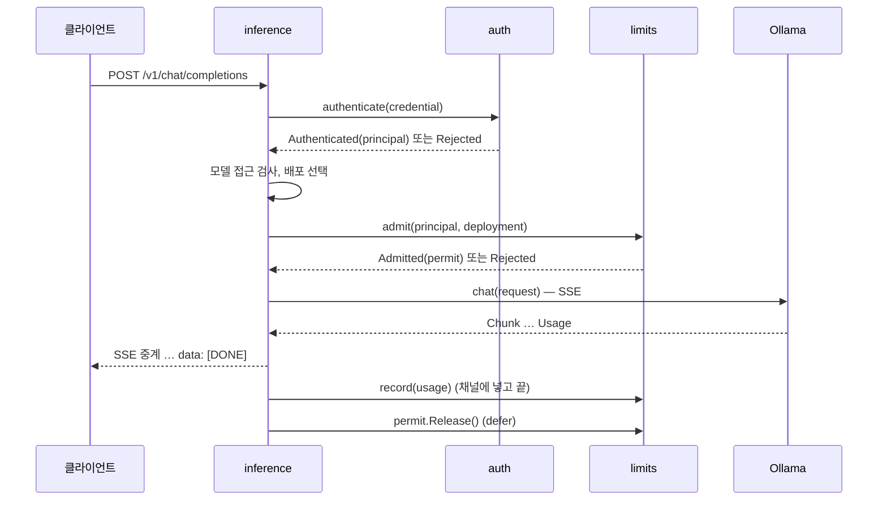

# Go 게이트웨이 설계안 (초안)

> 상태: 초안. 조사 7영역(`docs/litellm-inventory/A~G_*.md`) 결과와 확정된 결정만 근거로 쓴다. 확인하지 못한 것은 "미확인"
> 위치: 이 저장소(`llm-gateway`) 루트 설계 문서. 이전 저장소(litellm 포크)는 `../gateway`, 그쪽 문서·규칙은 `docs/legacy/` 에 참고용으로 둔다
> 이전 설계 `docs/legacy/GATEWAY_DESIGN.old.md`(Spring MVC + 가상 스레드, 클린슬레이트)를 이 문서가 대체한다. 스키마·에러 포맷·키 발급 흐름은 그쪽을 이어 쓴다
> 언어: 2026-11-21 Kotlin(Spring WebFlux)에서 **Go 로 바꿨다**. 이유는 단일 바이너리 배포와 배포 서버(`../deploy-server`, Go)와 같은 언어. Kotlin 진행분은 `archive/kotlin` 브랜치에 있다

---

## 1. 목적과 범위

Python litellm 프록시를 내리고, 폐쇄망용 LLM 게이트웨이를 Go 로 새로 만든다. 별개 서비스·새 저장소·독립 스키마다. 기존 데이터(키·사용량)는 옮기지 않는다.

- 추론 API: OpenAI 표준(`/v1/chat/completions`, `/v1/models`, `/v1/embeddings`)을 그대로 따른다. 클라이언트는 주소와 키만 바꾼다
- 인증·관리: 키·팀·사용자·모델·예산·사용량을 운영자가 직접 다룬다
- 비목표: litellm 의 부가 기능 전반(아래 12장), 유료(premium) 개념, 외부 SaaS 연동
- **원칙: 만드는 기능의 동작은 litellm 과 같게 하는 것이 기본이다.** 이 문서에는 litellm 과 다르게 하는 곳만 이유와 함께 적는다

## 2. 확정된 결정

| 항목 | 결정 |
|---|---|
| 서버 | Go 표준 `net/http`(1.22+ 패턴 라우팅). 웹 프레임워크는 쓰지 않는다 |
| 런타임 | Go(`go.mod` 의 `toolchain go1.26.11` 로 고정). `CGO_ENABLED=0` 단일 실행 파일, 재현 가능한 빌드(`build.sh check`). 배포 서버 `deploy-server` 와 같은 관례 |
| 의존성 | 표준 라이브러리 우선. 하나 더할 때마다 여기에 이유를 적는다. 지금: `github.com/jackc/pgx/v5`(PostgreSQL 드라이버·커넥션 풀. 표준 `database/sql` 만으로는 드라이버가 없다). 계획: Redis 를 켤 때 Redis 클라이언트 |
| DB 접근 | `pgx`(`pgxpool`). 블로킹 모양으로 쓰지만 Go 런타임이 소켓 I/O 를 논블로킹으로 처리한다. 모든 쿼리에 요청 `ctx` 를 넘겨 클라이언트가 끊으면 쿼리도 취소된다. 쓰기는 배치 goroutine 하나가 맡는다 |
| 사용량 기록 | 요청 후 채널에 넣고 끝낸다. 100건 또는 1초마다 묶어 `request_log` INSERT, `limit_policy.spend` 합산 UPDATE |
| 예산 확인 | DB 값 + 카운터 누적분(메모리 또는 Redis). 배치 주기만큼 늦게 막혀도 허용 |
| 인스턴스 | 수평 확장할 수 있어야 한다. 비정상 종료 시 인스턴스마다 최대 1초치 기록 유실 허용. 정상 종료 시 채널을 비운다 |
| Redis | 옵션. 공유 상태(예산·RPM·TPM·동시성 카운터, 키 차단 전파)는 `CounterStore` 포트 뒤에 둔다. Redis 가 없으면 메모리 구현으로 인스턴스 1개, 있으면 여러 대. 진실 원천은 PostgreSQL |
| 큐 초과 | 버퍼가 있는 채널. 가득 차면(`select` + `default`) 경고 로그와 지표를 남기고 버린다 |
| 데이터 | 독립 스키마. 기동 시 마이그레이션(litellm 의 Prisma migrate 와 같은 역할). 라이브러리 없이 직접 만든다: `embed` 로 넣은 SQL 파일을 번호 순으로, PostgreSQL advisory lock 을 잡고 적용하고 적용 기록 테이블을 남긴다. 여러 대가 동시에 기동해도 한 대만 적용한다. litellm 테이블과 무관. 이전 없음 |
| 프로바이더 | 1차 Ollama 한 종류. `LlmProvider` 로 추상화 |
| 모듈 경로 | `llm-gateway` (진입점 `cmd/llm-gateway`, 코드는 모두 `internal/`) |
| 폐쇄망 | 런타임 외부 호출 0. 호출 대상은 Ollama 와 Keycloak, PostgreSQL, (켰다면) Redis 뿐 |

## 3. 구조

**모듈러 모놀리스**로 만든다. 배포 단위는 하나이고, 안쪽은 기능 모듈로 나눠 경계를 테스트로 강제한다. 수평 확장은 같은 애플리케이션을 여러 대 띄우는 것이라 모듈 구조와 무관하다(공유 상태는 7장 `CounterStore`).

```
llm-gateway/
├── go.mod                  모듈 하나. 모듈 경계는 internal/ 아래 패키지로 나눈다
├── cmd/llm-gateway/        진입점(main.go) 하나 — app.Run 만 부른다
└── internal/
    ├── app/        조립 지점: 설정 읽기, 모듈 라우트를 모아 auth 권한 검사로 감싸 등록, 기동·정상 종료. 모든 모듈을 가져올 수 있는 유일한 패키지
    ├── inference/  /v1/* 라우트, 채팅 파이프라인, 배포 선택, SSE 중계, LlmProvider(인터페이스), Ollama 구현, 모델 배포 저장소(model_deployment)
    ├── auth/       키 검증(+캐시), Keycloak JWT, SSO, 라우트 권한 검사(Guard), 키·사용자·팀 발급·조회와 그 저장소(api_key, app_user, team, team_member)
    ├── limits/     예산·RPM/TPM/동시성 검사, 사용량 기록, CounterStore(인터페이스)·메모리/Redis 구현, 한도·사용량 저장소(limit_policy, request_log)
    ├── admin/      대시보드용 litellm 모양 관리 라우트, 빈 응답 핸들러. 자기 테이블은 `audit_log` 하나이고, 나머지는 다른 모듈의 공개 API 를 부른다
    └── core/       라우트 권한 선언(Route·Access·Role), litellm 모양 오류 응답, 헬스, 구조 로그(마스킹), 메트릭, 시계, 마이그레이션 실행기
```

모듈 규칙:
- **기능별로 나눈다.** 라우트·로직·저장소를 그 기능 모듈 안에 둔다. 계층(controller/service/repository)으로 나누지 않는다
- **공개 API 와 내부를 나눈다.** 대문자로 시작하는(export 된) 이름만 다른 모듈이 쓴다. 모듈 안에서만 쓰는 하위 패키지가 필요하면 `internal/<모듈>/internal/…` 에 두어 컴파일러가 바깥 참조를 막게 한다
- **테이블은 한 모듈만 소유한다.** 다른 모듈의 테이블을 직접 읽거나 쓰지 않고 소유 모듈의 공개 API 를 부른다
  - `auth` 는 신원(키 해시·사용자·팀·허용 모델·차단·만료)만, `limits` 는 한도·spend·리셋 시각(`limit_policy`)과 사용량(`request_log`)을 가진다. 배치와 리셋 job 은 `limits` 자기 테이블만 갱신한다
  - `request_log` 에는 기록 시점에 `key_id`·`user_id`·`team_id` 를 함께 남긴다. 사용량 집계는 `limits` 가 자기 테이블만으로 하고, 이름 같은 표시 정보는 `admin` 이 `auth` 에서 받아 붙인다
  - 대시보드 응답처럼 여러 모듈 값을 합친 모양은 `admin` 이 조립한다
- **라우트 권한은 라우트와 함께 선언한다.** 모듈은 라우트를 `core.Route{Method, Path, Access, Handler}` 목록으로만 내놓고, `app` 이 하나씩 `auth.Guard` 로 감싸 등록한다. 그래서 권한 선언이 없는 라우트는 만들 수 없다
  - 선언 타입(`Route`, `Access`, `Role`)은 `core` 에 둔다. `core` 의 헬스 라우트도 선언해야 하는데 `core` 는 `auth` 를 볼 수 없기 때문이다. 검사(`Guard`)는 `auth` 에 있다
  - 등록되지 않은 경로는 litellm(FastAPI) 기본과 같은 `404 {"detail":"Not Found"}` 다
- **의존은 한 방향, 순환 금지.** `app → admin → inference → auth·limits → core`. `auth` 와 `limits` 는 서로 가져오지 않는다. `cmd` 는 `app` 만 가져온다
- **인터페이스는 바깥과 닿는 곳에만 둔다.** Ollama(`LlmProvider`), Redis(`CounterStore`), Keycloak, 시계. 인터페이스는 쓰는 쪽 패키지에 둔다(Go 관례). 모듈 안을 헥사고날 계층으로 다시 나누지 않는다
- **모듈 간 호출은 직접 호출이 기본이다.** 결과가 필요 없는 알림만 이벤트로 보낸다
- **경계는 컴파일러와 테스트로 지킨다.** 순환 import 와 `internal/` 밖 참조는 Go 컴파일러가 막는다. 모듈 사이 의존 방향과 설계에 없는 모듈은 `internal/app/architecture_test.go` 가 import 를 읽어 막는다(`go test` 에 포함). 편집 시점에는 하네스 훅이 같은 규칙으로 먼저 막는다

핸들러는 표준 `http.HandlerFunc` 이고, 라우팅은 `http.ServeMux` 의 `"METHOD /path"` 패턴이다.

### 3.1 모듈 공개 API (초안)

이름과 모양은 뼈대를 만들며 다듬는다. 정해 두는 것은 **무엇을 공개하고 실패를 어떻게 돌려주는지**다. 예상되는 실패(예산 초과, 모델 없음)는 이름 붙은 오류 값(`var ErrBudgetExceeded = errors.New(…)`)이나 오류 타입으로 돌려주고 `errors.Is`·`errors.As` 로 가른다. `panic` 은 프로그래머 실수에만 쓴다.

```go
// auth
func (a *Authenticator) Authenticate(ctx context.Context, header http.Header) (Principal, error) // Bearer·x-api-key·JWT
var ErrKeyMissing, ErrKeyInvalid, ErrKeyExpired, ErrKeyBlocked error
type Principal struct {                         // 요청 하나 동안 다른 모듈에 넘기는 신원
    KeyID, UserID, TeamID string
    Role         core.Role
    AllowedModels ModelAccess
}
func (a *Authenticator) Guard(route core.Route) http.Handler   // 라우트 권한 검사. app 이 모든 라우트를 이것으로 감싼다
// 키·사용자·팀 발급·수정·차단·조회. admin 모듈만 부른다

// limits
func (g *Gate) Admit(ctx context.Context, p auth.Principal, d DeploymentRef) (*Permit, error)  // 예산·RPM·TPM·동시성을 한 번에 검사하고 슬롯을 잡는다
var ErrBudgetExceeded error
type RateLimitedError struct{ RetryAfter time.Duration }
func (p *Permit) Release()                      // 응답이 끝나거나 취소되면 defer 로 반납
func (r *UsageRecorder) Record(u UsageEvent)    // 채널에 넣고 바로 돌아온다(막히지 않는다)
// 기간·키·팀·사용자별 집계, limit_policy 설정·spend 리셋. admin 이 부른다

// inference
type LlmProvider interface {                    // 1차 구현은 Ollama
    Chat(ctx context.Context, req ChatRequest, target Deployment) (<-chan ProviderEvent, error)
    Embed(ctx context.Context, req EmbeddingRequest, target Deployment) (EmbeddingResult, error)
}
type ProviderEvent struct {                     // 청크 · 사용량 · 실패 중 하나
    Chunk *SseFrame
    Usage *Usage
    Err   error
}
// 모델 그룹·배포 조회. admin 과 /v1/models 가 쓴다

// core
type Route struct { Method, Path string; Access Access; Handler http.HandlerFunc }
type ProxyError struct { Status int; Message, Type string; Param any }   // 4.3 오류 모델. 본문을 만드는 곳은 core 한 곳
type ClusterBus interface {                     // 인스턴스 사이 알림. 메모리 구현은 자기 인스턴스에만 전달
    Publish(ctx context.Context, event ClusterEvent) error
    Subscribe(ctx context.Context) <-chan ClusterEvent
}
```

### 3.2 모듈 간 알림

| 이벤트 | 내는 곳 | 받는 곳 | 하는 일 |
|---|---|---|---|
| `KeyChanged(keyId)` | auth(키 수정·차단·삭제·재생성) | auth | 키 캐시에서 지운다 |
| `TeamChanged(teamId)` | auth | auth | 그 팀 키들의 캐시를 지운다 |
| `DeploymentChanged` | inference(모델 추가·수정·삭제) | inference | 배포 목록 캐시를 다시 읽는다 |
| `LimitPolicyChanged(scope, id)` | limits | limits | 한도 캐시를 지운다 |

- 같은 인스턴스 안에서는 받는 모듈이 등록한 함수를 직접 부르고(구독 목록), 다른 인스턴스로는 `ClusterBus` 로 보낸다. Redis 구현은 pub/sub, 메모리 구현은 아무 데도 보내지 않는다(인스턴스 1개라 필요 없다)
- pub/sub 은 메시지를 잃을 수 있다. 그래서 캐시에는 항상 TTL(키 30초, 배포 30초)을 둔다. 알림은 빨리 반영하는 수단이고 정확성은 TTL 이 보장한다(litellm 도 30초 주기 재조회 + pub/sub)

### 3.3 실행 구조 (goroutine 과 백그라운드 작업)

- 요청 처리는 `net/http` 가 요청마다 만든 goroutine 에서 하고, `r.Context()` 를 끝까지 넘긴다. 요청 안에서 goroutine 을 띄우면 같은 ctx 를 넘기고 끝나기를 기다린다(요청보다 오래 사는 goroutine 금지)
- 백그라운드 작업은 `app` 이 만든 루트 ctx 아래에서 띄우고 `sync.WaitGroup` 으로 모은다. 작업 하나가 실패해도(오류 로그) 다른 작업은 계속된다. 종료 때 루트 ctx 를 취소하고 모두 끝나길 기다린다

| 작업 | 모듈 | 주기 | 여러 대일 때 |
|---|---|---|---|
| UsageWriter | limits | 100건 또는 1초 | 인스턴스마다 돈다(각자 자기 채널) |
| 예산 리셋 | limits | 1분 | PostgreSQL advisory lock 으로 한 대만 |
| 배포 헬스체크·쿨다운 해제 | inference | 설정값 | 인스턴스마다(쿨다운은 인스턴스별로 둬도 된다. litellm 과 같다) |
| `ClusterBus` 구독 | core | 상시 | 인스턴스마다 |
| `request_log` 보관 기간 삭제 | limits | 하루 1회 | advisory lock 으로 한 대만 |

정상 종료 순서:
1. 새 요청을 받지 않는다(readiness 를 내린다)
2. 진행 중인 스트림이 끝나길 기다린다. 최대 대기 시간은 설정으로 두고, 넘으면 취소한다(취소된 요청도 부분 사용량을 기록한다)
3. 사용량 채널을 닫고 남은 것을 마지막 배치로 쓴다
4. 백그라운드 작업의 ctx 를 취소하고 끝나길 기다린 뒤 DB·Redis 연결을 닫는다

k8s 의 `terminationGracePeriodSeconds` 는 2번 대기 시간보다 길게 잡는다.

## 4. 추론 경로

| 단계 | 처리 | 실패 |
|---|---|---|
| 1 | `Authorization: Bearer` 또는 `x-api-key` → SHA-256 → 30초 캐시 → `api_key` 조회(미스일 때만 DB). 만료·삭제·차단 확인 | 401 |
| 2 | 모델 접근 검사(키·팀의 허용 모델) | 403 |
| 3 | 예산 확인: DB spend + `CounterStore` 누적분 < max_budget(키·팀) | 429 `budget_exceeded` |
| 4 | 속도 제한: RPM·TPM(고정 윈도우, `CounterStore`), 배포별 동시성 제한(`CounterStore`) | 429 `rate_limit_exceeded` |
| 5 | 배포 선택: model group 에서 가중 랜덤, `order` 우선순위, 쿨다운 중인 배포 제외 | 404 `model_not_found` |
| 6 | 업스트림 전달(5장). 첫 청크 전 실패는 다른 배포로 1회 재시도, 이후는 재시도 없음 | 502/503/504 |
| 7 | 응답 후 사용량을 채널에 넣는다 | 큐 초과 시 경고 후 버림 |

타임아웃은 connect 5초 / read 300초(로컬 모델 생성은 느리다). 오류 모양은 4.3.

### 4.1 모듈 사이 흐름



순서가 litellm 과 다른 점: 배포 선택(5단계)을 동시성 확인 앞에 둔다. 동시성 한도가 배포 단위라 어느 배포인지 알아야 슬롯을 잡을 수 있기 때문이다. 표의 단계 번호는 실패 응답 기준이다.

### 4.2 스트림 취소와 정리

- 클라이언트가 끊으면 `r.Context()` 가 취소되고, 같은 ctx 로 만든 업스트림 요청(`http.NewRequestWithContext`)이 끊긴다. 업스트림 연결이 닫혀 Ollama 도 생성을 멈춘다
- 정리는 `defer` 로 한다. 동시성 슬롯 반납과 부분 사용량 기록은 요청 ctx 가 이미 취소된 뒤에도 해야 하므로 `context.WithoutCancel(ctx)` 로 만든 ctx 로 한다(사용량 기록은 채널에 넣기만 하므로 ctx 가 필요 없다)
- 부분 사용량: 업스트림 usage 청크를 받기 전에 끊겼으면 받은 청크로 추정하고 `usage_source=estimate` 로 남긴다. 상태는 499
- 첫 청크 전 실패만 다른 배포로 1회 재시도한다. 첫 청크를 클라이언트에 보낸 뒤에는 재시도하지 않는다(응답이 섞인다)
- 스트림 중간에 업스트림이 끊기면 OpenAI 형식 error 이벤트를 보내고 닫는다. `request_log` 상태는 error

### 4.3 오류 모델

OpenAI 오류 형식을 쓴다(litellm 과 같다). 모듈은 이름 붙은 오류를 돌려주고, 본문을 만드는 곳은 core 한 곳(`internal/core/errors.go`)이다.

```json
{ "error": { "message": "...", "type": "...", "param": null, "code": "..." } }
```

| 실패 | HTTP | type | code |
|---|---|---|---|
| 키 없음·형식 오류·없는 키, 관리 라우트 역할 거부 | 401 | `auth_error` | `"401"` (message 는 `Authentication Error, …`, param 은 문자열 `"None"`) |
| 만료·차단된 키 | 401 | `auth_error` | `"401"` |
| 허용되지 않은 모델·경로 | 403 | `permission_error` | `model_not_allowed` / `forbidden` |
| 없는 모델 | 404 | `invalid_request_error` | `model_not_found` |
| 요청 형식 오류·컨텍스트 초과 | 400 | `invalid_request_error` | `bad_request` / `context_length_exceeded` |
| 예산 초과 | 429 | `rate_limit_error` | `budget_exceeded` |
| RPM·TPM·동시성 초과 | 429 | `rate_limit_error` | `rate_limit_exceeded` (+`Retry-After`, `x-ratelimit-*` 헤더) |
| 업스트림 5xx | 502 | `server_error` | `upstream_error` |
| 업스트림 연결 실패·쿨다운으로 배포 없음 | 503 | `server_error` | `upstream_unavailable` |
| 업스트림 타임아웃 | 504 | `server_error` | `upstream_timeout` |

code 문자열은 litellm 이 실제로 내는 값과 맞춘다(계약 테스트로 확인, 다르면 litellm 쪽을 따른다).
- 인증 행은 litellm 소스로 확인했다(`auth/auth_exception_handler.py` `_as_proxy_exception`, `_types.py` `ProxyException.to_dict`). litellm 의 `code` 는 OpenAI 코드가 아니라 HTTP 상태 문자열이다. 나머지 행은 해당 기능을 만들 때 같은 방법으로 확인해 고친다
- 관리 라우트에서 역할이 모자라면 litellm 은 403 이 아니라 401 을 준다(`auth/route_checks.py`). 대시보드가 이 상태로 동작하므로 따른다
- 등록되지 않은 경로는 `404 {"detail":"Not Found"}`(FastAPI 기본)

### 4.4 스트리밍 프레임
- 업스트림 SSE 를 줄 단위로 읽어 바로 클라이언트에 쓰고 `http.Flusher` 로 내보낸다. 모아서 보내지 않는다. 클라이언트가 느리면 쓰기가 막히고 그만큼 업스트림 읽기도 늦어진다(자연스러운 백프레셔)
- **클라이언트가 끊으면 업스트림 요청을 즉시 취소한다**(ctx 취소 전파). 그 시점까지의 부분 사용량을 기록한다. 부분 토큰은 추정치(`usage_source=estimate`)
- 업스트림에는 `stream_options.include_usage=true` 를 넣는다. 클라이언트가 켜지 않았으면 usage 청크만 걸러낸다
- keepalive 주석 프레임, 마지막 `data: [DONE]`, 스트림 중간 오류의 error 이벤트 전달
- 끊긴 요청은 litellm 처럼 그 시점까지 부분 과금하고 499 로 기록한다(조사 A). litellm 도 마지막에 `data: [DONE]` 을 보낸다

## 5. Ollama 어댑터

`/v1/chat/completions` 로 거의 그대로 전달한다(네이티브 `/api/chat` 은 쓰지 않는다). 바꾸는 것은 넷뿐이다.

1. `model` 별칭 → 실제 모델 태그. 응답의 `model` 은 요청한 이름으로 되돌린다
2. `stream_options.include_usage` 주입과 클라이언트용 usage 청크 제거(위 스트리밍)
3. 지원하지 않는 필드는 하나의 정책으로 통일한다. **추천: 조용히 삭제하지 않고 무시 목록을 설정으로 두며, 기본은 삭제 + 로그**. litellm 은 필드에 따라 400/조용한 삭제가 섞여 있어 혼란스럽다
4. 클라이언트의 `Authorization` 은 업스트림에 전달하지 않는다

litellm 의 `frequency_penalty → repeat_penalty` 이름 바꾸기는 의미가 달라 따라 하지 않는다.
확인함(2026-11-21, Ollama 0.40.13 · lfm3:1.7b): Ollama `/v1` 은 `stream_options.include_usage` 를 받아 마지막에 usage 청크(`choices: []`)를 준다. 그래서 스트림 사용량은 업스트림 값(`usage_source=provider`)으로 남는다. 미확인: `tool_choice`, `reasoning_effort`, `json_schema`, `n`, `logprobs` 처리. 이전 저장소 `../gateway/docker-dev/` 의 실물 Ollama 로 확인해 결과를 4장 계약 테스트에 넣는다.
`num_ctx`(컨텍스트 길이)는 `/v1` 로 못 바꾼다(외부 지식, 미확인). 필요해지면 Modelfile 로 배포하거나 네이티브 경로를 후순위로 추가한다.

## 6. 인증과 권한

- **가상 키**: `sk-` 형식, SHA-256 해시만 저장, 원문은 발급 응답에서 1회만 반환
- **마스터 키**: 환경 변수·시크릿으로만 주입. 없으면 **기동을 거부한다**(litellm 은 override 로 풀 수 있다)
- **Keycloak JWT**: API 를 JWT 로 직접 호출할 수 있게 한다. 서명은 Keycloak JWKS(내부 주소)로 검증하고 캐시한다. litellm 에서 유료로 막힌 핵심 기능이다
- **SSO(OIDC, PKCE)**: Keycloak 전용. 그룹 → 팀·역할 매핑. 신규 사용자 기본값. **사용자 수 제한 없음**
- **아이디·비밀번호 로그인(사용자 결정 2026-11-21)**: SSO 와 함께, **모든 사용자**가 게이트웨이 계정(app_user)의 아이디·비밀번호로도 로그인한다(이전의 "비상 관리자 하나만"을 넓힘)
  - 데스크탑: CLI SSO 흐름의 브라우저 단계(`/sso/key/generate`)에서 로그인 페이지를 보이고 "회사 계정(SSO)"·"아이디·비밀번호" 중 고른다. 어느 쪽이든 같은 방식으로 키를 발급해 `/sso/cli/poll` 로 넘긴다. 데스크탑 코드는 바꾸지 않는다
  - 대시보드: litellm 의 아이디·비밀번호 로그인(`/login`)을 그대로 받는다
  - 비밀번호는 litellm 처럼 초대 링크(`/invitation/new` → 온보딩)에서 사용자가 정하거나, 관리자가 `/user/update` 로 정한다
  - 저장: 표준 라이브러리 PBKDF2-SHA256(소금·반복 횟수 포함 문자열). 로그인 시도 제한. 외부 유출 비밀번호 검사(pwnedpasswords)는 하지 않는다(폐쇄망)
  - 로그인 페이지 흐름의 세부(SSO 를 켰을 때 litellm 의 `/sso/key/generate` 동작과의 관계)는 `docs/litellm-inventory/K_sso_cli_contract.md` 를 보고 정한다
  - **어떤 로그인 방식을 둘지는 빌드 시점에 정한다(사용자 결정 2026-11-21).** `LOGIN=sso,password ./build.sh`(기본 둘 다), `LOGIN=password`, `LOGIN=sso`. `-ldflags -X` 로 바이너리에 고정하고 실행 중에는 바꿀 수 없다. 꺼진 방식은 라우트를 등록하지 않는다(404, 로그인 페이지에도 없음). 값이 틀리면 빌드가 실패하고, 기동 로그에 빌드된 로그인 방식을 남긴다. Keycloak 주소·client id 같은 연결 정보는 고객사 환경마다 달라 환경 변수로 받는다
- **역할**: litellm 역할 문자열을 그대로 쓴다(대시보드가 이 값으로 메뉴를 나눈다). `proxy_admin`, `proxy_admin_viewer`, `internal_user`, `internal_user_viewer`, `team`. 조직·고객 계층(`org_admin`, `customer`)은 만들지 않는다
- **라우트 권한은 허용 목록**(역할별로 허용 경로를 적는다). litellm 의 viewer 쓰기 차단은 차단 목록이라 새 API 를 빠뜨리면 뚫린다
- 세션 쿠키는 litellm 과 같이 `token` 쿠키로 둔다. 대시보드가 `document.cookie` 로 읽으므로 HttpOnly 로 할 수 없다(조사 B). SameSite=Lax
- 미확인: oauth2-proxy 헤더 인증의 유료 여부(쓰지 않으므로 영향 없음)

## 7. 예산·제한

조사에서 나온 사실이 설계를 바꾼다: **litellm 은 단가표에 없는 모델(Ollama 포함)의 비용을 0 으로 계산하고, 비용 0 인 모델은 예산 검사를 건너뛴다.** 폐쇄망에서는 $ 예산이 사실상 걸리지 않는다.

- 한도 단위는 **토큰**(TPM·일일 토큰·기간 토큰)을 기본으로 둔다
- $ 예산은 **배포(model_deployment)에 단가를 직접 넣은 모델에만** 적용한다. 단가가 없으면 비용 0 이고 토큰 한도만 걸린다. 가격표 자동 다운로드는 하지 않는다(번들 JSON 도 두지 않고 운영자 입력만)
- 예산 확인은 `CounterStore` 의 카운터를 본다. 응답 직후 카운터를 올리고 DB 는 배치로 반영한다(litellm 도 같은 구조다). 카운터 채우기는 아래 규칙을 따른다
- RPM·TPM 은 고정 윈도우. 카운터는 `CounterStore` 에 둔다
- `CounterStore` 구현은 둘이다. 메모리(기본, 인스턴스 1개 전용)와 Redis(옵션, 여러 대). 설정으로 고르고, Redis 없이 여러 대를 띄우면 한도가 대수만큼 늘어나므로 지원하지 않는다
- 카운터 채우기: 메모리 구현은 기동 시 DB 값으로 채운다. Redis 구현은 키가 **없을 때만** DB 값으로 채우고(`SET NX`), 있으면 Redis 값을 그대로 쓴다(지금 주기는 Redis 가 가장 정확하고 DB 는 배치만큼 늦다). Redis 가 비워지면 다음 요청에서 같은 규칙으로 다시 채운다. 최대 1초치 배치분이 덜 세어질 수 있고, 이미 허용한 오차다
- Redis 카운터 키의 TTL 은 예산 주기(`budget_reset_at`)와 RPM·TPM 윈도우에 맞춘다. 주기가 바뀌면 키가 저절로 사라진다
- Redis 를 쓰면 키 차단·삭제를 pub/sub 로 알려 모든 인스턴스의 키 캐시를 지운다. 메모리 구현은 자기 캐시만 지운다
- spend 는 배치에서 `spend = spend + ?` 로 더한다(여러 인스턴스가 같은 행을 갱신해도 맞게)
- 예산 주기 리셋은 `budget_reset_at` 컬럼과 주기 job 으로 한다. litellm 은 600초 간격이라 최대 10분 늦는다. 새 설계는 1분 간격이면 충분하다(추천). 여러 대일 때 한 대만 실행되게 PostgreSQL advisory lock 을 잡는다
- 요청 전에 최대 비용을 미리 잡는 예약 방식은 만들지 않는다(1차에는 과하다)

### 7.1 CounterStore

```go
type CounterStore interface {
    // 고정 윈도우 카운터를 올리고 올린 뒤 값을 돌려준다. 한도 검사와 증가를 원자적으로 한다
    IncrementIfBelow(ctx context.Context, key CounterKey, amount, limit int64, window time.Duration) (CounterResult, error)
    Add(ctx context.Context, key CounterKey, amount int64, ttl time.Duration) error        // 응답 후 토큰·spend 반영
    Get(ctx context.Context, keys []CounterKey) ([]*int64, error)
    SeedIfAbsent(ctx context.Context, key CounterKey, value int64, ttl time.Duration) error // 7장 카운터 채우기 규칙
    AcquireSlot(ctx context.Context, key CounterKey, limit int, lease time.Duration) (SlotResult, error) // 동시성
    ReleaseSlot(ctx context.Context, key CounterKey, slot SlotID) error
}
```

| 카운터 | 키(Redis 기준) | 값 | 만료 |
|---|---|---|---|
| RPM | `gw:rpm:{scope}:{id}:{분}` | 요청 수 | 윈도우 끝 |
| TPM | `gw:tpm:{scope}:{id}:{분}` | 토큰 수(응답 후 더함) | 윈도우 끝 |
| 기간 spend | `gw:spend:{scope}:{id}:{주기 시작}` | 비용(소수 6자리 고정소수) | `budget_reset_at` |
| 기간 토큰 | `gw:tok:{scope}:{id}:{주기 시작}` | 토큰 수 | `budget_reset_at` |
| 동시성 | `gw:conc:{deploymentId}`, `gw:conc:{scope}:{id}` | 슬롯 집합(만료 시각 점수) | 임대 시간 |

- `scope` 는 `key`·`team`, 배포 동시성은 `deployment`
- 메모리 구현은 `sync.Mutex` 로 지키는 맵(또는 `sync.Map` + `atomic.Int64`), Redis 구현은 Lua 스크립트로 검사와 증가를 한 번에 한다
- **동시성 슬롯은 임대(lease)로 잡는다.** 인스턴스가 죽으면 반납이 안 되므로 슬롯마다 만료 시각을 두고, 긴 스트림은 진행 중에 임대를 연장한다. 만료된 슬롯은 다음 획득 때 지운다
- spend 를 `numeric` 대신 고정소수(정수)로 세는 것은 Redis 의 원자 증가가 정수·실수만 지원하기 때문이다. DB 에는 `numeric` 으로 남긴다
- 키 범위(예: 키 + 팀)를 함께 검사할 때는 한 스크립트에서 모두 확인한 뒤 모두 올린다. 하나라도 넘으면 아무것도 올리지 않는다

## 8. 스키마 (이전 설계 7테이블 + 조사로 보강)

조사(G)에서 새 7테이블에 빠져 있던 것 중 **넣을 것**:
- `limit_policy`(`limits` 소유, scope=키·팀 + 대상 id): `max_budget`, `spend`, `tpm_limit`, `rpm_limit`, `max_parallel`, `budget_duration`, `budget_reset_at`
- `api_key`·`team`(`auth` 소유): `blocked`
- `model_deployment`: `input_cost_per_token`, `output_cost_per_token`(없으면 비용 0)
- `audit_log`: 관리 변경 기록(litellm 은 유료라 쓰지 않았지만 운영자에게 필요하다). 후순위로 둬도 된다
- 키 재생성은 `key_hash` 교체 + 옛 해시 유예 기간(`previous_key_hash`, `previous_expires_at`)

**넣지 않을 것**: 조직·프로젝트·고객, MCP·에이전트·벡터·프롬프트·워크플로 같은 부가 기능 테이블 약 50개, 삭제 사본 테이블(soft delete 로 대체), 일별 롤업(처음에는 `request_log` GROUP BY. 느려지면 추가), 요청·응답 본문 컬럼(litellm 도 기본 꺼짐. 폐쇄망 감사에 본문이 필요하다고 정해지면 추가).
### 8.1 테이블 (초안)

| 테이블 | 소유 | 주요 컬럼 |
|---|---|---|
| `app_user` | auth | `id`, `email`(unique), `name`, `role`(litellm 역할 문자열), `sso_subject`(Keycloak `sub`, unique), `password_hash`(비상 관리자만), `created_at`, `deleted_at` |
| `team` | auth | `id`, `alias`(unique), `models`(허용 모델), `blocked`, `created_at`, `deleted_at` |
| `team_member` | auth | `team_id`, `user_id`, `role`(`admin`·`user`), PK(team_id, user_id) |
| `api_key` | auth | `id`, `key_hash`(unique), `key_prefix`(표시용), `name`, `user_id`, `team_id`, `models`, `blocked`, `expires_at`, `previous_key_hash`, `previous_expires_at`, `last_used_at`, `created_at`, `deleted_at` |
| `limit_policy` | limits | `scope`(`key`·`team`), `target_id`, `max_budget`, `spend`, `tpm_limit`, `rpm_limit`, `max_parallel`, `budget_duration`, `budget_reset_at`, `updated_at`, PK(scope, target_id) |
| `model_deployment` | inference | `id`, `model_name`(클라이언트가 부르는 이름, 그룹), `provider`, `base_url`, `upstream_model`, `api_key_encrypted`, `weight`, `order`, `max_parallel`, `input_cost_per_token`, `output_cost_per_token`, `active`, `created_at`, `updated_at` |
| `request_log` | limits | `request_id`, `created_at`, `key_id`, `user_id`, `team_id`, `model`, `deployment_id`, `prompt_tokens`, `completion_tokens`, `usage_source`(`provider`·`estimate`), `cost`, `status`(`success`·`error`·`cancelled`), `http_status`, `error_code`, `latency_ms`, `ttft_ms` |
| `audit_log` | admin | `id`, `created_at`, `actor_user_id`, `action`, `target_type`, `target_id`, `before`, `after`(jsonb, 비밀 값 제외) |

- 다른 모듈의 id 를 가리키는 컬럼(`request_log.key_id`, `limit_policy.target_id` 등)에는 외래 키를 걸지 않는다. 모듈 경계를 넘는 제약이고, 삭제는 soft delete 라 고아 행이 생기지 않는다. 같은 모듈 안(`api_key.team_id → team`)에는 건다
- `request_log` 인덱스: (`created_at`), (`key_id`, `created_at`), (`team_id`, `created_at`), (`user_id`, `created_at`). 파티셔닝은 보관 기간 삭제가 느려지면 월 단위로 추가한다
- 세션 저장 테이블은 두지 않는다. 세션은 litellm 과 같이 서명된 `token` 쿠키(JWT)라 서버 상태가 없고, 여러 대여도 sticky session 이 필요 없다

spend 는 `numeric` 으로 저장한다(litellm 은 Float). 스키마 변경은 마이그레이션 파일(`<4자리 번호>_<이름>.sql`)로만 하고, 적용된 파일은 고치지 않는다. 마이그레이션은 스키마만 바꾼다(행을 다시 쓰는 UPDATE·DELETE 금지).

## 9. 관리 API

조사(C): litellm 관리 엔드포인트는 514행, 이 중 **필수 41 / 후순위 150 / 제외 323**.

**필수 최소 세트**: 키(generate·update·delete·info·list·block·unblock·reset_spend), 팀 CRUD·멤버 add/delete/update·차단, 사용자 CRUD·`/me`, 모델(new·update·delete·info·그룹 정보), 헬스 프로브 3개, Keycloak 로그인·콜백·로그아웃, 사용자·팀 일별 사용량.

**결정(사용자 확인)**: UI 는 **공식 litellm 대시보드**(`../gateway/ui/litellm-dashboard`, Next.js. 이하 `ui/` 경로는 이전 저장소 기준)를 계속 쓴다. 따라서 기존 설계의 자체 `/api/v1/*` spec 은 **폐기**하고, **대시보드가 쓰는 화면에 한해 litellm 관리 API 와 같은 경로·요청·응답 모양**으로 만든다. (`ui/ko-dashboard` 는 저장소에 없고 설계 문서에만 있던 것이라 쓰지 않는다)

진행 방식:
1. **대시보드는 코드 수정 없이 그대로 쓴다**(사용자 결정). 서버 설정 `enabled_ui_pages_internal_users` 는 일반 사용자에게만 적용되고(`leftnav.tsx:142` 의 `!isAdmin` 조건) 관리자 메뉴는 그대로 보인다. 그래서 만들지 않는 기능의 엔드포인트는 **화면이 깨지지 않는 빈 응답**(빈 목록·기본값)으로 답한다. 화면은 `ui/litellm-dashboard/src/app/(dashboard)/` 폴더 기준이고, 아래 분류는 "동작을 보장할 화면"과 "빈 응답으로 두는 화면"이다(폴더 이름만 보고 나눈 것이라 각 화면의 실제 동작은 미확인)
   - **동작 보장**: `home`, `api-keys`, `teams`, `users`, `models-and-endpoints`, `model-hub-table`, `usage`, `logs`, `playground`, `change-password`, `ui-theme`, `api-reference`
   - **빈 응답(확정)**: `guardrails`, `guardrails-monitor`, `policies`, `tool-policies`, `workflows` (사용자 결정. 가드레일 엔진과 정책 기능은 1차에 만들지 않는다)
   - **빈 응답(제안, 미확정)**: `mcp-servers`, `agents`, `skills`, `memory`, `prompts`, `organizations`, `projects`, `tag-management`, `vector-stores`, `lens`, `cost-optimization`, `logging-and-alerts`(외부 SaaS 콜백), `telemetry`(폐쇄망 원칙상 반드시 숨김)
   - **쓰는지 확인 필요(그때까지 빈 응답, M5 후보)**: `budgets`(별도 예산 객체 필요), `cost-tracking`, `router-settings`, `caching`, `admin-panel`, `access-groups`, `model-insights`, `old-usage`, `transform-request`, `search-tools`
2. 동작을 보장할 화면이 부르는 엔드포인트만 구현한다. 나머지 화면의 엔드포인트는 대시보드가 부르는 경로 전부를 빈 응답으로 받아 준다(목록은 대시보드 소스에서 뽑는다). 모양의 근거는 대시보드의 타입 클라이언트(`ui/litellm-dashboard/src/lib/http/schema.d.ts`, OpenAPI 에서 생성)와 litellm OpenAPI 스냅샷(`litellm/proxy/_lazy_openapi_snapshot.json`)이다. 이 둘로 **계약 테스트**를 만든다(요청·응답 필드가 같은지)
3. 대시보드를 새 게이트웨이에 실제로 붙여 화면마다 브라우저로 확인한다(M3·M4 종료 기준)

규모: **대시보드 화면은 전부 쓴다**(사용자 결정). 대시보드가 부르는 관리 엔드포인트 전부(조사 추정 최대 약 269개, 정규식 추정이라 동적 경로는 놓쳤을 수 있음)를 처음부터 등록하고, 실제 구현(필수 최소 41개부터)과 빈 응답 중 하나로 답한다.

위험(확인 필요):
- **유료(premium) 기능은 라이선스로 잠그지 않는다.** 대시보드에 주는 `premium_user` 같은 플래그는 항상 켜진 값으로 줘서 화면이 잠기거나 업셀 문구가 뜨지 않게 한다. 유료 기능이 필요해지면 우리가 직접 만든다(그 전까지는 빈 응답)
- 안 만드는 기능의 화면이 관리자 메뉴에 그대로 남는다. 빈 응답이 화면을 깨뜨리지 않는지 **화면마다 브라우저로 확인**해야 하고, 깨지는 화면은 그 엔드포인트 응답의 모양을 조정한다(UI 는 고치지 않는다). 확인 전에는 몇 개가 깨질지 알 수 없다
- **이번에는 백엔드만 바꾼다**(사용자 결정). 대시보드는 지금 소스(`ui/litellm-dashboard`)와 지금 배포 방식(`ui/Dockerfile` 의 nginx 컨테이너가 정적 파일을 서빙)을 그대로 쓰고, nginx 의 백엔드 주소만 새 게이트웨이로 바꾼다. 코드는 수정하지 않고, upstream 대시보드 업데이트는 따라가지 않고 고정한다. 프런트를 어떻게 할지는 나중에 정한다
- litellm 의 모양을 따르므로 응답에 litellm 의 유료 기능 빈자리 필드가 남을 수 있다. 계약 테스트에서 필요한 필드만 본다

**litellm 과 다르게 하는 것(버그라서 따르지 않는다, 사용자 결정)** — 근거는 `docs/litellm-inventory/H_team_user_contract.md`
- `/team/info`·`/team/list` 응답에 키 해시(`token`)를 넣지 않는다. litellm 은 팀의 키 목록에 해시를 그대로 노출한다
- `/user/update` 에 없는 `user_id` 가 오면 만들지 않고 404 로 답한다. litellm 은 proxy_admin 이 부르면 새 사용자를 만든다
- SSO 로 처음 들어온 사용자의 별칭은 litellm 기본(Keycloak `sub` UUID, K 2.4) 대신 `name`(없으면 `preferred_username`) 클레임을 쓴다. 데스크탑이 별칭을 이름으로 보이기 때문이다
- 대시보드 세션 키도 데스크탑과 같은 자기 완결 로그인 키다(`L_dashboard_login_contract.md`). litellm 은 로그인마다 DB 에 가상 키(`team_id="litellm-dashboard"`, 예산 1 USD)를 하나씩 만들고 지우지 않는다. 그래서 세션 키에 1 USD 예산이 없고 `/key/list` 에 나올 일이 없다. 로그아웃은 그 사용자의 대시보드 세션을 **모두** 끊는다(사용자 행의 `ui_sessions_revoked_at` 보다 먼저 발급된 세션을 거부한다. litellm 은 그 세션 하나만). 데스크탑 로그인 키는 로그아웃과 상관없다
- 대시보드 세션도 7일간 유효하다(litellm `LITELLM_UI_SESSION_DURATION` 기본 24시간)
- 대시보드 관리자 로그인(`admin` + 마스터 키, litellm `UI_USERNAME`·`UI_PASSWORD` 기본)은 SSO 만 넣은 빌드에서도 된다. 대시보드를 처음 여는 길이기 때문이다. DB 사용자의 비밀번호 로그인은 비밀번호를 넣은 빌드에서만 된다
- 키 재발급(`/key/{key}/regenerate`)의 `grace_period`(옛 키를 정한 시간 동안 더 받기)는 아직 받지 않는다. 재발급하면 옛 키는 바로 401 이다(뒤 단계)
- 팀원별 예산(`max_budget_in_team`, 팀원 예산 일괄 수정)은 아직 없다. 팀원 사용액은 늘 0 이고, 값을 정하려는 요청은 결과 행에 실패로 남긴다(뒤 단계)
- 모델 추가 폼의 제공자는 우리가 중계하는 Ollama·Ollama Chat·Hosted vLLM 만 보인다. 업스트림 API 키(`api_key` 등)는 저장하지 않는다
- 사용량·로그 화면(`N_usage_logs_contract.md`)은 litellm 의 일별 집계 표 대신 `request_log` 를 그때그때 묶어 만든다. 그래서 다음이 다르다:
  - 로그의 키 별명·팀 이름은 요청 시점 값이 아니라 지금 값이다
  - 사용자 없는 키(서비스 계정)로 비관리자가 로그를 보면 litellm 은 전부 보여 주지만 우리는 아무것도 보여 주지 않는다
  - 클라이언트가 끊은 요청(취소)도 실패로 센다
  - 본문·세션·태그·캐시·최종 사용자는 기록하지 않으므로 빈 값으로 내고, 그 값으로 거르면 빈 결과다
- 부팅 설정의 `proxy_base_url` 은 늘 null 이다. 대시보드는 자기 출처로 API 를 부른다(nginx 가 대시보드와 API 를 같은 출처로 낸다)
- 데스크탑이 받는 로그인 키(`litellm_login_…`)는 7일간 유효하다. litellm 기본은 24시간(`CLI_JWT_EXPIRATION_HOURS`)이다. 요청마다 사용자·팀을 다시 읽으므로 차단·팀 제외는 기간과 상관없이 바로 반영된다
- 데스크탑 로그인 화면은 빌드에 SSO 와 비밀번호가 둘 다 있으면 둘 중 고르게 한다(litellm 원본은 SSO 만, 포크는 설정으로 하나만)
- `/v2/team/list` 를 일반 사용자가 `user_id` 없이 부르면 호출자 id 로 채운다. litellm 은 채우는 코드가 실행되지 않아 401 을 준다(`I_team_user_screens_contract.md`)
- 팀원은 `team_member` 한 곳에만 둔다. litellm 은 팀의 `members_with_roles` 와 사용자의 `teams` 두 곳에 따로 저장해 v1·v2 목록이 어긋날 수 있다. 응답 모양은 litellm 과 같게 두 필드 모두 `team_member` 에서 만든다

## 10. 폐쇄망 검증

litellm 에서 **기본으로 외부에 나가는 것**(조사 B·D·E·F): 모델 가격표(GitHub), 블로그 RSS, GitHub 최신 릴리스 확인, Anthropic beta 헤더·오토라우터·정책 템플릿 원격 로딩, HuggingFace 토크나이저, pwnedpasswords, 라이선스 검증, telemetry. 새 게이트웨이는 **해당 기능을 만들지 않는다**.
검증: e2e 를 외부 네트워크를 막은 컨테이너(Ollama·Keycloak·Postgres 만 연결)에서 돌려 외부 연결 시도가 0 임을 본다. 코드에는 사설·내부 주소 외 URL 이 들어가지 않게 린트로 막는다(`docs/legacy/gateway-rules/architecture.md` 5번 방식을 이어 쓴다).
로그: 구조 JSON, 기본 INFO(litellm 은 DEBUG 가 기본이라 요청 본문이 남을 수 있다). 키·토큰·Authorization 은 마스킹. 요청 본문은 기본으로 남기지 않는다.

## 11. 운영 구성

### 11.1 설정

설정은 환경 변수로 받는다(설정 파일 없음). 모델 배포·키·팀·한도는 DB(관리 API)로 다루고 설정 파일에 두지 않는다.

| 키 | 기본값 | 뜻 |
|---|---|---|
| `GATEWAY_LISTEN` | `:4000` | 수신 주소. litellm 기본 포트와 같다 |
| `GATEWAY_DATABASE_URL` | 없음(필수, M1 DB 부터) | PostgreSQL 연결 문자열 |
| `GATEWAY_MASTER_KEY` | 없음(필수) | 없으면 기동 거부. 환경 변수·시크릿으로만 |
| `GATEWAY_COUNTER_STORE` | `memory` | `memory` 또는 `redis` |
| `GATEWAY_REDIS_URL` | 없음 | `counter-store=redis` 일 때 필수 |
| `GATEWAY_LIMITS_FAIL_CLOSED` | `false` | Redis 장애 시 요청 거부 여부(litellm `fail_closed_rate_limit_enforcement`) |
| `GATEWAY_USAGE_BATCH_SIZE` / `_FLUSH_INTERVAL` / `_QUEUE_CAPACITY` | `100` / `1s` / `10000` | 사용량 배치 |
| `GATEWAY_KEY_CACHE_TTL` | `30s` | 키 캐시 |
| `GATEWAY_UPSTREAM_CONNECT_TIMEOUT` / `_READ_TIMEOUT` | `5s` / `300s` | 업스트림 |
| `GATEWAY_DRAIN_TIMEOUT` | `60s` | 정상 종료 시 스트림 대기 |
| `GATEWAY_REQUEST_LOG_RETENTION` | `90d` | 보관 기간 |
| `GATEWAY_KEYCLOAK_ISSUER` / `_CLIENT_ID` | 없음 | SSO·JWT |
| `GATEWAY_SECRETS_ENCRYPTION_KEY` | 없음(필수) | `model_deployment.api_key_encrypted` 암호화 키 |

설정 키 이름은 우리 것으로 두되, 같은 뜻의 litellm 설정이 있으면 표에 함께 적는다.

### 11.2 배포 형태

| 형태 | 구성 | 쓰는 곳 |
|---|---|---|
| 작은 사이트 | 게이트웨이 1대 + PostgreSQL (+ Ollama, Keycloak) | 기본. `counter-store=memory` |
| 확장 | 게이트웨이 N대(로드밸런서 뒤) + PostgreSQL + Redis (+ Ollama, Keycloak) | `counter-store=redis` |

- 대시보드는 지금 nginx 컨테이너를 그대로 쓰고, nginx 가 API 경로를 게이트웨이(또는 로드밸런서)로 넘긴다
- 컨테이너 이미지는 폐쇄망 반입용으로 만든다. 런타임에 아무것도 내려받지 않는다
- 헬스: liveness·readiness 는 litellm 과 같이 인증 없이 연다. readiness 는 DB 연결(Redis 를 켰으면 Redis 도)을 본다

### 11.3 관측

- 메트릭: Micrometer + Prometheus 형식 `/metrics`(인증 여부는 litellm 기본을 따른다). 요청 수·지연·첫 토큰까지 시간·토큰 수(모델·키·팀별), 429 사유별 수, 사용량 채널 길이와 버린 건수, 배치 쓰기 실패, Redis 서킷 상태, 배포별 동시 요청 수
- 로그: 구조 JSON, 기본 INFO. 요청마다 요청 ID 를 남기고 응답 헤더로도 돌려준다(litellm `x-litellm-call-id` 와 같은 이름). 키·토큰·`Authorization` 은 마스킹하고 본문은 남기지 않는다
- 트레이싱: 1차에는 넣지 않는다. 필요해지면 폐쇄망 안의 수집기로만 보낸다

### 11.4 테스트

| 층 | 무엇을 | 어떻게 |
|---|---|---|
| 단위 | 한도 계산, 배포 선택, 오류 변환, SSE 정규화 | `runTest`, 가짜 `Clock`·`LlmProvider`·`CounterStore` |
| 모듈 | 모듈 하나의 공개 API 동작 | 패키지 단위 `go test`, 다른 모듈은 인터페이스 가짜 |
| 경계 | 순환 의존, `internal` 참조, 라우트 권한 선언 누락 | `ApplicationModules.verify()`, 라우트 검사 테스트 |
| 계약 | OpenAI SDK 요청·응답 모양, 대시보드가 기대하는 관리 API 모양 | OpenAI SDK 실호출, 대시보드 `schema.d.ts`·litellm OpenAPI 스냅샷과 비교 |
| 저장소 | pgx 쿼리, 마이그레이션, Redis Lua 스크립트 | 실제 PostgreSQL·Redis. 테스트 도우미가 `docker run` 으로 띄우고(외부 패키지 없이 `os/exec`), `GATEWAY_TEST_DATABASE_URL` 이 있으면 그것을 쓴다. Docker 가 없으면 건너뛰지 않고 실패한다(CI 에서 조용히 빠지지 않게). 폐쇄망 CI 는 이미지를 미리 반입 |
| e2e | 실제 Ollama 스트리밍, 끊김 시 취소, 외부 연결 0 | 외부 네트워크를 막은 compose |
| 확장 | 2대 + Redis 에서 한도 공유, 키 차단 전파 | compose 에 게이트웨이 2대 |

## 12. 단계

| 단계 | 내용 | 끝났다는 기준 |
|---|---|---|
| M1 (완료 2026-11-21) | 신원 기반: DB(pgx·마이그레이션), 마스터 키 인증, 라우트 권한 선언, 오류 envelope, 팀·사용자·팀원 관리 API(litellm 모양) | 마스터 키로 팀·사용자를 만들고 팀에 사용자를 넣고 조회한다. 다른 키·키 없음은 401 |
| M2 | 키 발급·수정·차단·삭제·조회(`/key/*`), 키 검증(30초 캐시) | 발급한 키로 인증되고, 차단하면 401 |
| M3 | 추론 프록시: chat(스트리밍)·models·embeddings, 모델 관리 API, 예산·제한, 배치 기록, 사용량 조회, `/metrics` | OpenAI SDK 가 주소·키만 바꿔 동작, 클라이언트 끊김 시 업스트림 취소 확인, 운영자가 사용량을 본다 |
| M4 | Keycloak SSO·JWT 직접 인증, 그룹 매핑, 대시보드 | SSO 로그인으로 키 발급, JWT 로 API 호출 |
| M5 | 후순위 필요한 것만: `/v1/completions`, `/v1/responses`, `/v1/messages`, 이미지·음성, openai-compatible 프로바이더. **빈 응답으로 둔 화면을 필요할 때 실제 기능으로 교체**(예: 예산 객체, 비용 설정, 라우터 설정, 가드레일). 교체는 화면 단위로 하나씩 | 사용자가 요청한 것만. 교체한 화면은 브라우저에서 동작 확인 |

**순서 변경(2026-11-21, 사용자 결정): lite 데스크탑에서 쓰는 기능을 먼저 만든다.** 데스크탑은 API 키(기본) 또는 SSO CLI 흐름으로 붙고 `/v1/models`, `/v1/chat/completions`(스트리밍), `/model_group/info` 를 부른다. 그래서 M3 의 추론 경로 핵심(모델 배포 등록 `/model/new`, 위 세 라우트, 모델 접근 검사, 스트림 중계·끊김 취소)을 M2 직후 먼저 만들었다. 이어서 데스크탑 SSO(`/sso/cli/start`·`/sso/cli/poll`·`/sso/key/generate`, M4 의 일부)와 계정 화면이 부르는 `/v2/user/info`·`/key/info`·`/team/info`·`/user/daily/activity`·`/spend/logs` 를 먼저 하고, 예산·속도 제한·사용량 기록·대시보드 나머지는 그 뒤에 한다.

**빈 응답 → 실제 기능 교체를 쉽게 하는 구조**: 관리 API 의 경로마다 핸들러를 한 곳(`admin/routes`)에 등록하고, 빈 응답용 핸들러(`StubHandler`)를 실제 핸들러로 바꾸는 것만으로 교체되게 한다. 경로·요청·응답 모양은 대시보드가 이미 기대하는 것이라 바뀌지 않는다. 기능이 늘어도 UI 는 손대지 않는다.

**제외**(조사 A·F·B): files·batches·fine_tuning·assistants·vector_stores·realtime·A2A·MCP(약 5.4만 줄)·프로바이더 패스스루(약 1.8만 줄, 기본 업스트림이 외부 주소)·자동 라우터(약 1.2만 줄)·외부 SaaS 콜백 약 58종·외부 SaaS 가드레일 약 40종·조직·SCIM·알림·청구 내보내기.
가장 큰 구현 덩어리는 스트리밍 안정성(끊김 과금, 첫 청크 버퍼링, keepalive, 취소). litellm 은 이 로직이 `common_request_processing.py` 4830줄 안에 있다.

## 13. 아직 정하지 못한 것

(지금 남은 항목 없음)

정한 것: **CI·린트는 `check.sh` 하나**다(배포 서버와 같다). gofmt · `go vet` · `go test`(모듈 경계 테스트 포함) · govulncheck · 다른 OS vet · 재현 가능한 빌드 · 하네스 훅 테스트. 별도 린터(golangci-lint 등)는 들이지 않는다. 이전 저장소 규칙 중 제품 원칙(`docs/legacy/gateway-rules/product.md`)은 이어 가고 fork·upstream 규칙은 버린다

litellm 과 같게 하기로 정리한 것(1장 원칙):
- 가드레일이 차단하면 HTTP 200 + `finish_reason=content_filter`(가드레일을 만들 때 적용)
- `/v1/models` 의 응답 형식과 클라이언트별 변형은 litellm 과 같게 한다
- 요청·응답 본문 저장은 기본으로 끄고 설정으로 켤 수 있게 한다
- Redis 장애 시: 기본은 인스턴스 자기 메모리 카운터로 이어서 처리하고 경고 로그를 남긴다. 설정(`fail_closed_rate_limit_enforcement` 와 같은 뜻)을 켜면 요청을 거부한다. Redis 호출은 서킷 브레이커로 감싼다(litellm `parallel_request_limiter_v3.py`, `dual_cache.py`)

## 14. 이전 저장소(`../gateway`, Python 쪽)에 별도로 남는 일

새 게이트웨이 전환과 무관하게, 전환이 끝나기 전까지 운영 중이라면: 기본 외부 호출 6곳(가격표·블로그 RSS·릴리스 확인 등)을 끄는 설정, `LITELLM_LOG` 기본 DEBUG, `ui/Dockerfile` 의 nginx 1.31.5 패치(공지 영향 범위 1.31.0~1.31.8).
